# MyHouse + MyPro — System Design Specification

**The Operating System for Home Ownership.** This is not a marketplace. The
reverse marketplace is one workflow among many. The platform models the entire
lifecycle of a home digitally: every asset, document, warranty, repair, and
service interaction becomes structured data in a knowledge graph that makes the
system smarter with every event.

> **Reading guide** — ✅ = implemented in this repository today ·
> 🔭 = target-state design the current architecture deliberately leaves room for.
> All diagrams are Mermaid and render directly on GitHub.

---

## 1. Executive Overview

| Dimension | Position |
|---|---|
| Product | Two tightly-coupled surfaces — **MyHouse** (homeowner OS) and **MyPro** (service-business OS) — over **one shared record** |
| Core asset | The **Home Knowledge Graph**: an append-only, per-address record of assets, repairs, warranties, and outcomes that compounds in value |
| Architecture | **Modular monolith** behind an API gateway — nine service modules + an intelligence layer, splittable into microservices without app changes ✅ |
| Data flywheel | issue → structured job → bid → repair → **repair record** → contractor profile + model reliability + predictions + matching → better next issue ✅ |
| Privacy stance | tenant isolation by design (404-not-403), k-anonymized cross-home aggregates, PII scrubbing, differential-privacy hooks ✅ |
| Scale path | one house → millions: stateless gateway replicas, per-module extraction, Postgres/Redis/S3/Neo4j/pgvector behind existing abstractions 🔭 |

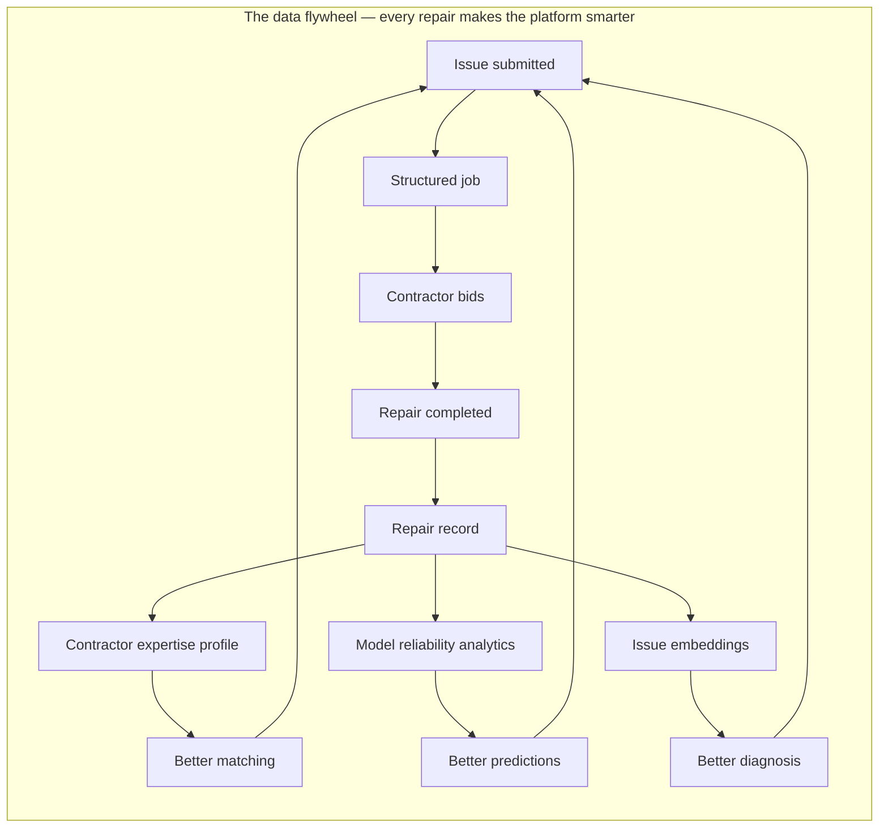

---

## 2. C4 Level 1 — System Context

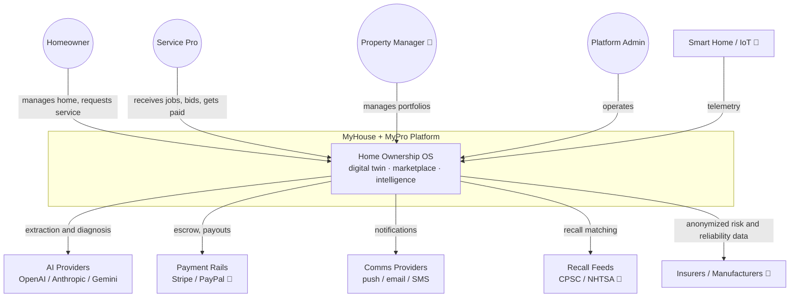

---

## 3. C4 Level 2 — Containers

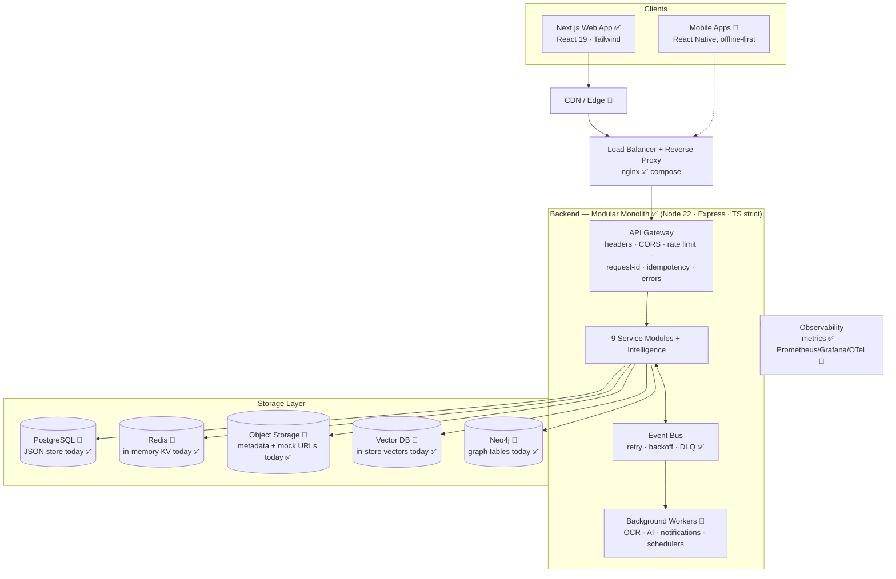

---

## 4. C4 Level 3 — Backend Components (Modular Monolith) ✅

**Boundary rules (enforced today):** modules expose routers + typed functions
only; no module touches another module's tables directly; cross-module
side-effects travel over the event bus; every module lifts out to a
microservice without app-code changes.

```mermaid
flowchart TB
    GW["API Gateway — src/gateway/app.ts"]

    subgraph CORE["core/ — cross-cutting, dependency-free"]
        CFG["config<br/>fail-fast env schema"]
        ERR["errors<br/>typed hierarchy"]
        RBACC["rbac<br/>policy engine + tenancy"]
        VAL["validate<br/>zod schemas"]
        KV["redis KV<br/>cache · locks · rate limits"]
        MET["metrics<br/>Prometheus text"]
        EVT["events<br/>queue · retries · DLQ"]
    end

    subgraph SVC["services/ — one module per domain"]
        AUTH["auth<br/>JWT + refresh families · MFA ·<br/>sessions · lockout · audit"]
        USERS["users<br/>homes · family roles ·<br/>scoped memberships"]
        ASSETS["assets<br/>inventory · files ·<br/>append-only history"]
        WARR["warranties<br/>parser · reminder engine"]
        MKT["marketplace<br/>jobs · bids · state machine ·<br/>optimistic locking"]
        NOTIF["notifications<br/>channels · prefs · quiet hours"]
        AI["ai<br/>extract + diagnose pipelines ·<br/>provider fallback chain"]
        PAYS["payments<br/>escrow · ledger · refunds ·<br/>reconciliation"]
        SEARCH["search<br/>fuzzy · weighted · paginated"]
    end

    subgraph INTEL["intelligence/ — the data network"]
        GRAPH["graph<br/>nodes + append-only edges"]
        LEARN["learning<br/>event consumers ·<br/>repair records · profiles"]
        EMB["embeddings<br/>vectors + similarity"]
        PRED["predictive<br/>hazard curves · RUL"]
        MATCH["matching<br/>9-factor explainable scoring"]
        ANA["analytics<br/>k-anonymized aggregates"]
        REC["recommend<br/>recalls · claims · seasonal"]
        PRIV["privacy<br/>k-anonymity · DP noise ·<br/>PII scrub · retention"]
    end

    GW --> AUTH & USERS & ASSETS & WARR & MKT & NOTIF & AI & PAYS & SEARCH
    GW --> INTEL
    SVC -- publish --> EVT
    EVT -- consume --> LEARN
    EVT -- consume --> NOTIF
    LEARN --> GRAPH & EMB
    MATCH --> LEARN
    ANA --> PRIV
    SVC --> CORE
    INTEL --> CORE
```

---

## 5. C4 Level 4 — Code (two representative slices) ✅

### Marketplace job acceptance (transactional escrow)

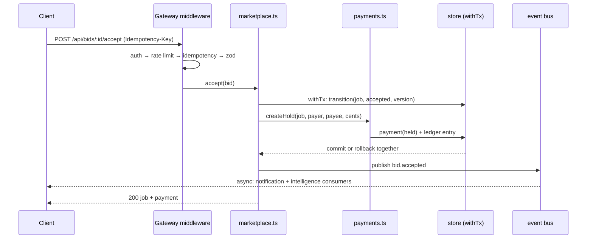

### Learning consumer (continuous improvement)

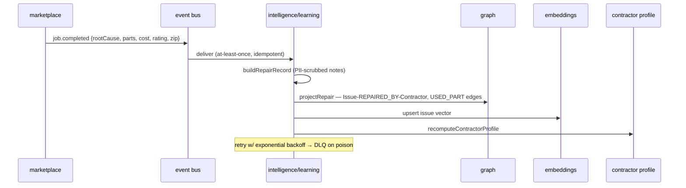

---

## 6. Frontend Architecture

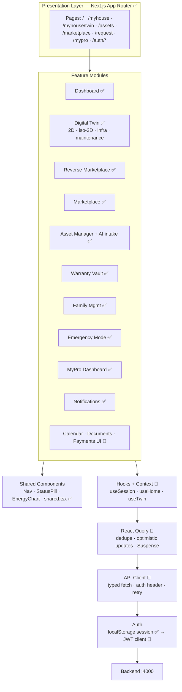

**Migration note 🔭:** today feature modules read from `lib/*` mock stores; the
cutover replaces `lib/` internals with the API client while page components
stay untouched — that seam is why the mocks live in `lib/`, not in components.

---

## 7. Data Architecture — ER Diagrams ✅

Engine mapping: **PostgreSQL** = relational rows below · **Redis** = sessions,
rate limits, idempotency, caches · **S3** = file bytes (rows keep metadata) ·
**pgvector/Vector DB** = `ISSUE_VECTOR.vector` · **Neo4j** = `GRAPH_NODE`/`GRAPH_EDGE`.

### 7.1 Identity, tenancy, and access

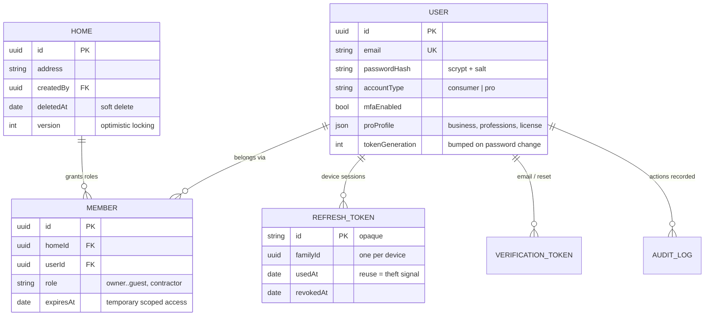

### 7.2 Home, assets, and documents

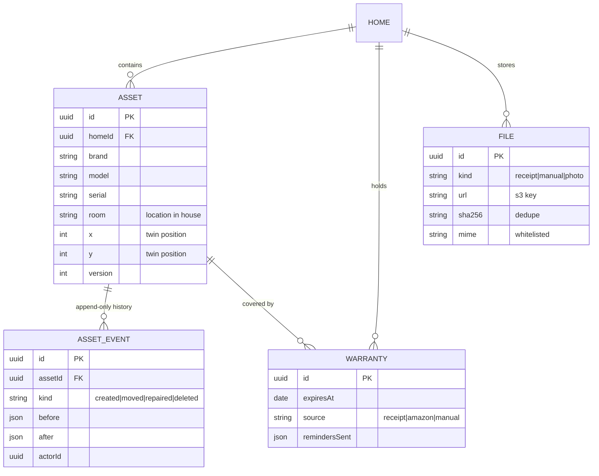

### 7.3 Marketplace and payments

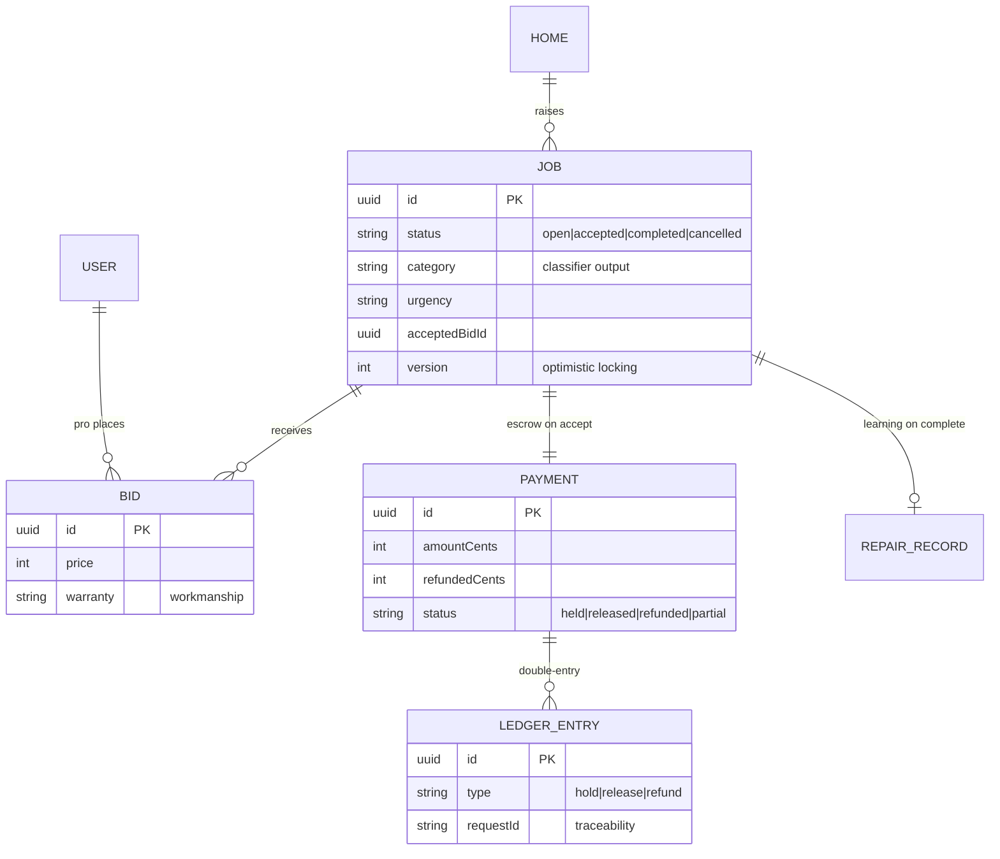

### 7.4 Intelligence layer

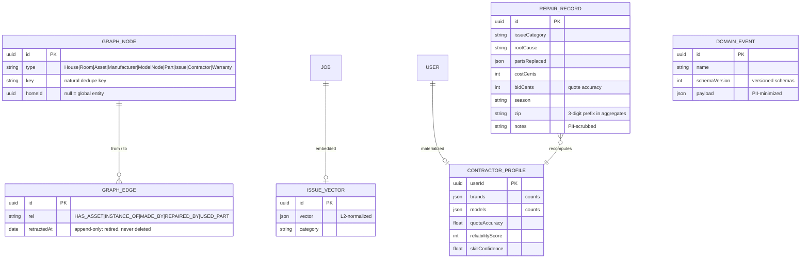

---

## 8. Reverse Marketplace — End-to-End Flow ✅

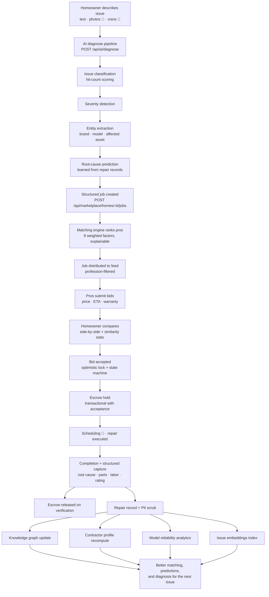

---

## 9. Service Category Taxonomy

Categories are **data, not code**: the classifier vocabulary, pro professions,
and matching factors are configuration rows, so adding "Holiday Lighting
Installation" is a taxonomy insert — no new module. The same job → bid → escrow
→ repair-record loop serves all of them.

| Cluster | Examples (60+ supported by the same pipeline) |
|---|---|
| Core trades | plumbing, electrical, HVAC, roofing, painting |
| Cleaning | deep/window/carpet/kitchen/bathroom, pressure washing, move-in/out |
| Flow & vents | drain, sewer, water line, dryer vent, chimney, gutters |
| Outdoor | lawn, landscaping, tree trimming, snow/leaf removal, pool, solar wash |
| Removal | junk, bulk waste, appliance/furniture removal, recycling pickup |
| Install & inspect | smart home, security, EV charger, internet, home/termite inspection |
| Recurring ops 🔭 | trash collection, pet waste, housekeeping, generator maintenance |
| Professional | inspector, interior designer, architect, property manager |

Recurring services reuse the marketplace with a `recurrence` field on JOB 🔭 —
the event bus already re-emits scheduled jobs the same way one-off jobs flow.

---

## 10. AI Pipeline ✅ (providers swappable per stage)

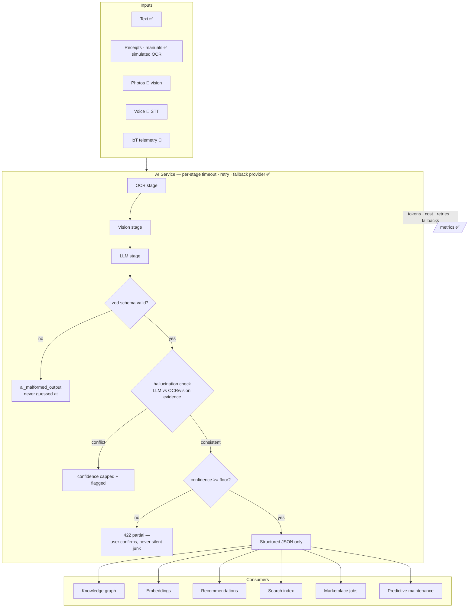

---

## 11. Knowledge Graph ✅

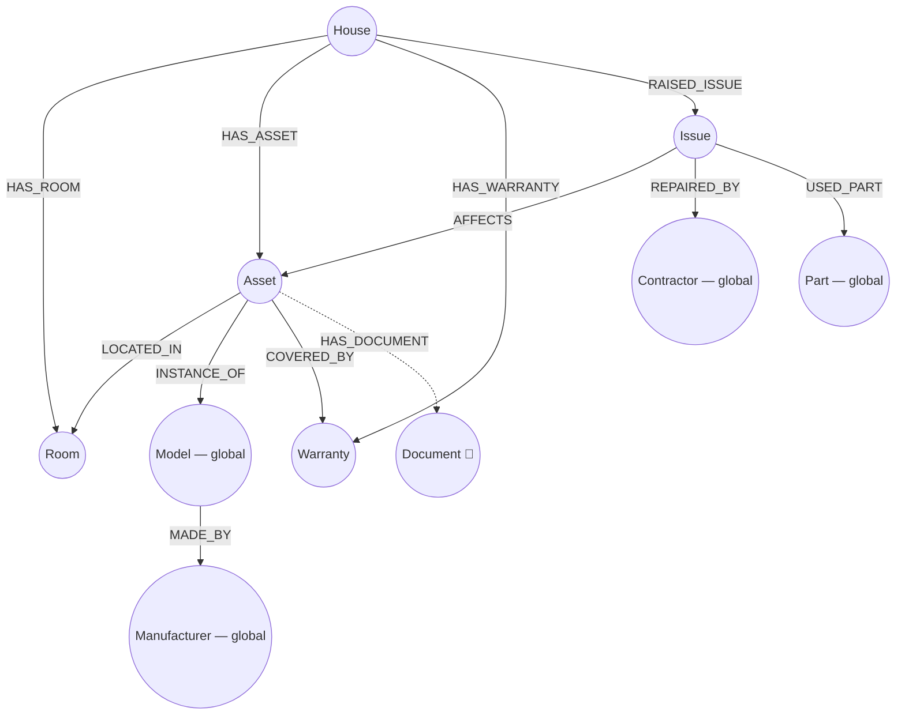

Properties that make this ML-grade: every node has a **globally unique id**;
edges are **append-only** (`retractedAt` retires, never deletes → full
relationship history); Manufacturer/Model/Part/Contractor nodes are **global
and deduped** across tenants, so cross-home learning happens at the model
level while home subgraphs stay tenant-guarded.

---

## 12. Recommendation Engine ✅

```mermaid
flowchart LR
    subgraph IN["Inputs"]
        A[Asset ages + lifespans]
        B[Cohort model analytics]
        C[Own repair history]
        D[Warranty expirations]
        E[Recall feeds]
        F[Seasonality]
        G[Issue embeddings]
    end
    RANK["Ranking engine<br/>priority: recall → replace →<br/>warranty claim → repair →<br/>seasonal → efficiency"]
    subgraph OUT["Proactive feed"]
        O1[Recalls — free remedy]
        O2[Replace-vs-repair decisions]
        O3[Claims before expiry]
        O4[Preventative inspections]
        O5[Seasonal maintenance]
        O6[Efficiency upgrades + credits]
    end
    IN --> RANK --> OUT
```

---

## 13. API Layer ✅

| Route prefix | Module | Highlights |
|---|---|---|
| `/api/auth` | Auth | signup/login/refresh/logout(-all), sessions, MFA, password flows |
| `/api/users` | Users | homes CRUD, family members, scoped/expiring roles, audit |
| `/api/assets` | Assets | inventory, files (presigned mock), position, **/history** |
| `/api/warranties` | Warranties | create/parse, reminder scan |
| `/api/marketplace` | Marketplace | jobs, feed, bids, accept (escrow), complete (capture) |
| `/api/payments` | Payments | release, refund (partial), ledger, integrity |
| `/api/notifications` | Notifications | list, read, preferences, quiet hours |
| `/api/ai` | AI | extract, **diagnose**, providers |
| `/api/search` | Search | global fuzzy weighted search, recents |
| `/api/intel` | Intelligence | graph, predictions, recommendations, matches, similar, reliability, analytics |
| `/health /live /ready /metrics /api/flags` | Platform | probes, Prometheus, feature flags |

### Gateway request lifecycle

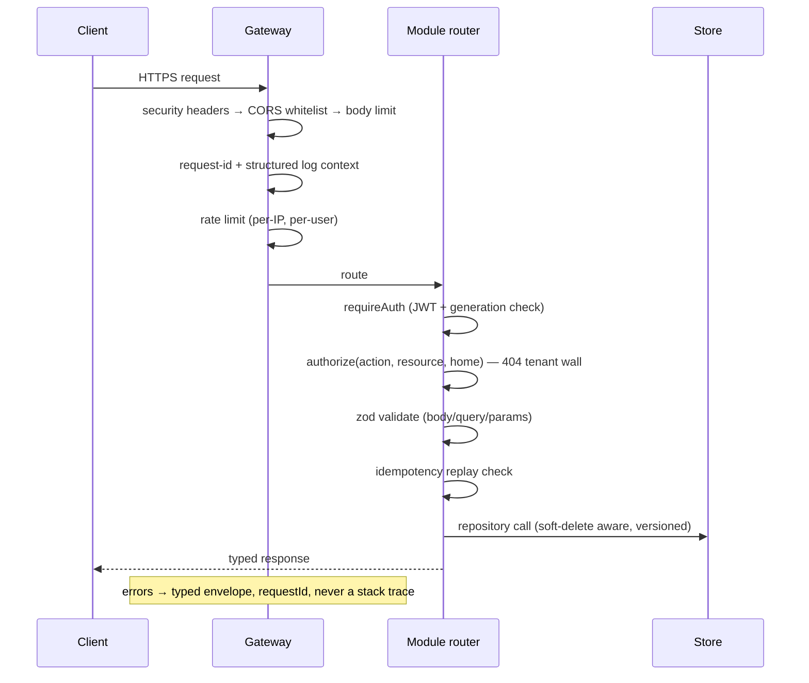

---

## 14. Event-Driven Architecture ✅

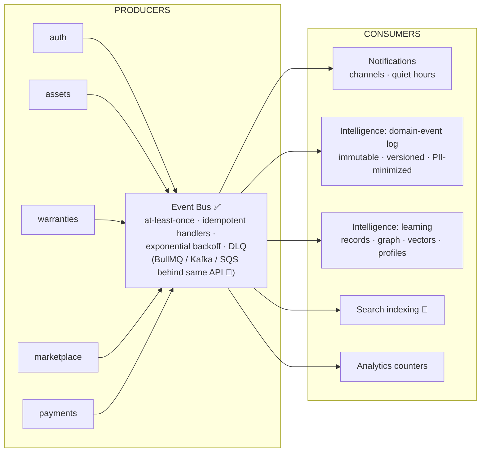

**Event catalog:** `user.signed_up` · `asset.created` · `warranty.expiring` ·
`job.created` (v2) · `bid.placed` · `bid.accepted` · `job.completed` (v2) ·
`payment.released` · `auth.suspicious` — every payload lands in the immutable
`domainEvents` log with a **schema version**, so future ML training data
survives payload evolution.

---

## 15. Infrastructure & Deployment

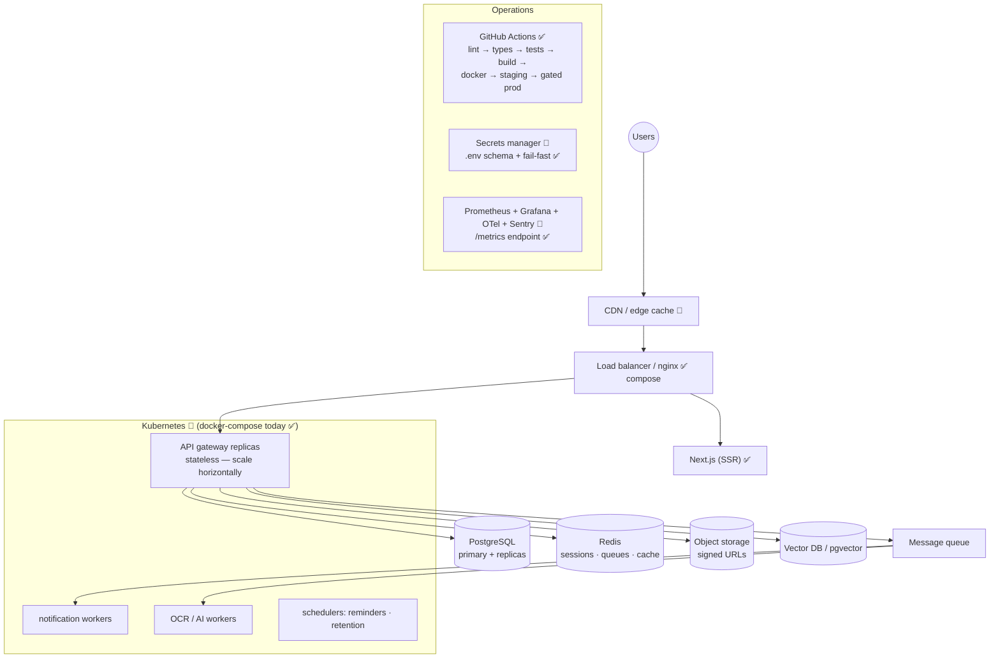

Environments: `development → test → staging → production`, each with isolated
data stores ✅ (per-env `DATA_DIR` today, per-env databases 🔭).

---

## 16. Security Architecture ✅

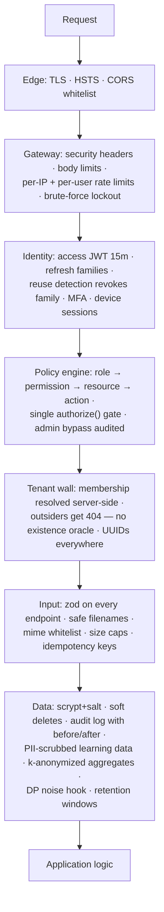

Extended to intelligence ✅: `intel` is a first-class RBAC resource (children
and guests are denied), cross-home statistics pass a k-anonymity floor
(`INTEL_MIN_COHORT`), regional analytics use 3-digit ZIP prefixes only, and
free text is scrubbed before entering any learning table.

---

## 17. Analytics Layer

| Audience | Dashboard content | Source |
|---|---|---|
| Homeowner | home health score, predictions, spend history, energy | `/api/intel/homes/:id/*` ✅ |
| Contractor | first-time-fix, quote accuracy, repeat rate, expertise profile | `/api/intel/contractors/me/profile` ✅ |
| Admin | event counts, active homes, DLQ depth, queue stats | `/api/analytics/summary` + `/ready` ✅ |
| Marketplace ops | bid depth, acceptance rate, time-to-fill 🔭 | domain-event log |
| AI ops | tokens, cost, fallbacks, hallucination flags, stage latency | `/metrics` ✅ |
| Data network | graph growth, cohort coverage, model reliability movement | analytics module ✅ |

---

## 18. User Journeys (sequence diagrams)

### New homeowner onboarding → first intelligence

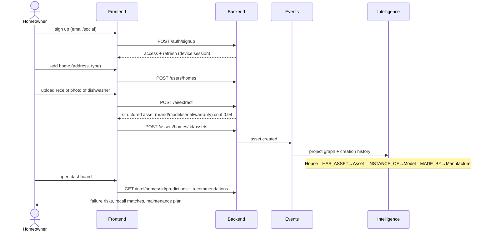

### Issue → repair → payment → learning loop

```mermaid
sequenceDiagram
    actor H as Homeowner
    actor P as Pro
    participant API as Backend
    participant PAY as Payments
    participant INT as Intelligence

    H->>API: POST /ai/diagnose "dishwasher not draining e24"
    API-->>H: category, root causes (learned), ranked pros
    H->>API: POST /marketplace/homes/:id/jobs
    P->>API: GET /marketplace/jobs/feed → POST bid
    H->>API: GET /intel/jobs/:id/similar (cohort stats)
    H->>API: POST /bids/:id/accept
    API->>PAY: escrow hold (same transaction)
    P->>P: performs repair
    H->>API: POST /jobs/:id/complete {rootCause, parts, rating}
    API->>PAY: release on verification
    API->>INT: job.completed → record, graph, profile, vectors
    H->>API: review 🔭 (rating captured at completion today)
    Note over INT: next identical issue anywhere gets better answers
```

---

## 19. Repository / Module Layout ✅

```text
UrbanClap/
├─ app/                      # Next.js App Router (frontend)
│  ├─ myhouse/ (+ twin/)     # dashboard + digital twin
│  ├─ assets/ marketplace/ request/ mypro/ auth/*
├─ components/  lib/         # shared UI · data/mock stores (API seam)
├─ backend/
│  ├─ src/gateway/           # API gateway (middleware chain, mounts)
│  ├─ src/core/              # config·errors·rbac·validate·redis·metrics·events·flags
│  ├─ src/services/          # auth·users·assets·warranties·marketplace·
│  │                         # notifications·ai·payments·search
│  ├─ src/intelligence/      # graph·learning·embeddings·predictive·
│  │                         # matching·analytics·recommend·similarity·privacy·router
│  ├─ src/db/store.ts        # typed store + migrations (PG repos later)
│  ├─ tests/ (72)            # unit·integration·security·tenant·intel
│  ├─ docs/                  # ARCHITECTURE·SECURITY·RUNBOOK·openapi·ADRs
│  └─ Dockerfile  scripts/smoke.ts
├─ docs/SYSTEM-DESIGN.md     # ← this document
├─ ci/github-actions-ci.yml  # move to .github/workflows (needs workflow scope)
├─ docker-compose.yml  e2e/  load/
```

---

## 20. Microservice Split Roadmap 🔭

Strangler-fig order, chosen by scaling pressure and blast radius:

```mermaid
flowchart LR
    M["Modular monolith ✅"] --> S1["1. AI Service<br/>bursty, GPU-adjacent,<br/>already isolated behind provider API"]
    S1 --> S2["2. Notifications<br/>pure event consumer —<br/>zero synchronous callers"]
    S2 --> S3["3. Search + Embeddings<br/>own index store, read-heavy"]
    S3 --> S4["4. Payments<br/>PCI boundary, audit isolation"]
    S4 --> S5["5. Intelligence analytics<br/>batch/OLAP workload profile"]
    S5 --> CORE2["Core stays: auth · users · homes ·<br/>assets · marketplace (transactional heart)"]
```

Why it's cheap later: modules already communicate only via routers + events,
never shared tables; the event bus API matches BullMQ/Kafka semantics
(at-least-once, idempotent consumers, DLQ); repositories hide the store.

---

## 21. Future Expansion (no redesign required)

| Expansion | Mechanism already in place |
|---|---|
| HOAs / apartment complexes | `MEMBER.role` is open-ended; a Community entity is a HOME-like tenant with bulk membership ✅ pattern |
| Rental portfolios / property managers | `property_manager` role exists in RBAC today ✅ |
| Insurance companies | consume k-anonymized reliability + risk aggregates via the analytics API ✅ shape |
| Manufacturers | warranty-fulfillment jobs enter the same marketplace pipeline; recall feed adapter slots into `recommend.ts` ✅ shape |
| IoT / smart home | telemetry lands as `ASSET_EVENT(kind: condition)` + events on the bus — same learning consumers 🔭 |
| Municipal services (trash, recycling) | recurring-job taxonomy rows + scheduling module 🔭 |
| Mobile apps | same gateway, JWT + refresh families already device-aware ✅ |

---

*Written against commit `02d1dc5` on branch `intelligence`. Companion docs:
[backend/README.md](../backend/README.md),
[backend/docs/ARCHITECTURE.md](../backend/docs/ARCHITECTURE.md),
[backend/docs/SECURITY.md](../backend/docs/SECURITY.md),
[backend/docs/openapi.yaml](../backend/docs/openapi.yaml), ADRs in
[backend/docs/adr/](../backend/docs/adr/).*
